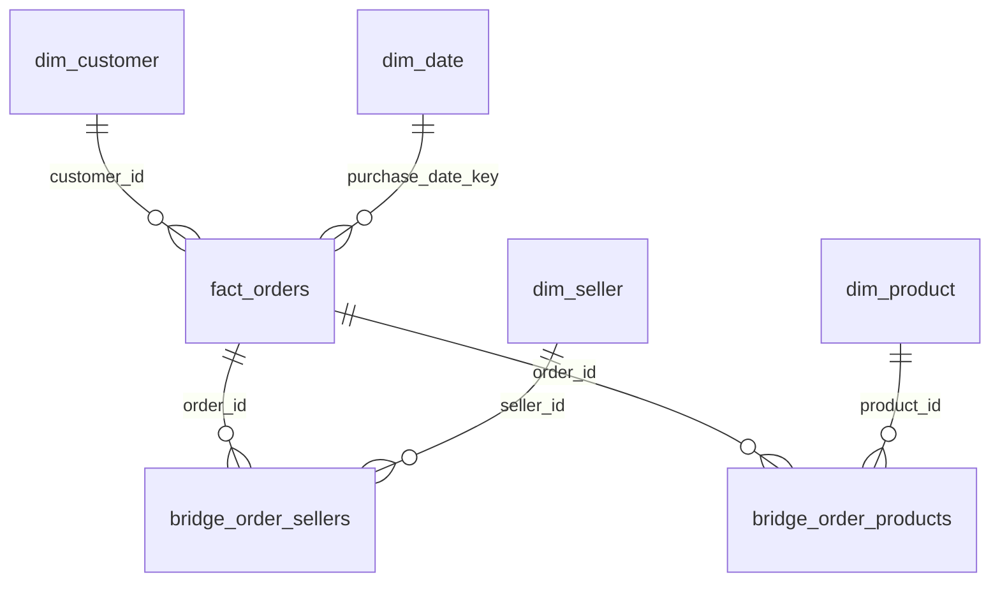

# Architecture and data schema

The local Python package has a small batch interface and a separate HTTP interface:

```text
original raw CSVs
    -> header/field/key validation + cleaning
    -> staging SQLite database: nine relational source tables
    -> dimensions + bridges + one-order fact table
    -> integrity/grain/total checks + historical summaries
    -> committed report records
    -> atomic publication to data/processed/fulfilliq.sqlite3
```

The downloader uses Python's standard library; the processing layer uses Pandas and
NumPy; SQLAlchemy defines the source schema and manages SQLite transactions. Mart
aggregations are SQL executed through SQLAlchemy. FastAPI/Pydantic expose typed health
responses and generated OpenAPI. No request retrains a model or triggers ingestion.

## Code boundaries

| Module | Responsibility |
| --- | --- |
| `config.py` | Resolve local paths from the environment |
| `cli.py` | Parse command arguments and format results/errors |
| `ingestion/download.py` | Fetch pinned original CSVs, headers and checksums |
| `ingestion/validation.py` | Validate columns/keys and report deterministic coercions |
| `ingestion/pipeline.py` | Stage, load, verify, publish and export reports |
| `db/schema.py` | SQLAlchemy relational source schema and filename allowlist |
| `db/mart.py` | Reporting schema and safe SQL aggregates |
| `db/integrity.py` | Independent physical, foreign key, grain and total checks |
| `analytics/service.py` | Initial descriptive statistics and data-quality counts |
| `api/health.py` | Read-only readiness check |
| `api/main.py`, `api/schemas.py` | Routing and typed HTTP contract |

## Relational source grain

All source identifiers are retained as strings except integer item/payment sequence
numbers. CSV header spellings, including `product_name_lenght`, are preserved.

| Source table | Grain / primary key | Relationships |
| --- | --- | --- |
| `customers` | One `customer_id` | `customer_unique_id` links repeat buyers; not a primary key |
| `orders` | One `order_id` | Required customer FK |
| `sellers` | One `seller_id` | Referenced by items |
| `products` | One `product_id` | Optional category; translations may be missing |
| `order_items` | `(order_id, order_item_id)` | Required order, product, seller FKs |
| `order_payments` | `(order_id, payment_sequential)` | Required order FK |
| `order_reviews` | Generated `review_row_id` | Required order FK; original `review_id` retained and nonunique |
| `geolocation` | Generated `geolocation_row_id` | Many observations per ZIP prefix |
| `category_translation` | One Portuguese category name | English translation may be null |

Generated row IDs are ingestion-local keys, not replacements for original identifiers.
All FK constraints are enabled for writes. Category translation and ZIP availability are
reported as coverage gaps rather than invalid foreign keys.

## Star-schema-style historical mart



`dim_customer` and `dim_seller` retain source location attributes; `dim_product` adds
English category translation through a left join. `dim_date` contains observed purchase
dates, with integer YYYYMMDD keys, weekday Monday=0 and calendar quarter 1–4. Missing
purchase timestamps leave the nullable fact date key empty. This is a snapshot mart,
not a slowly changing dimension system.

`zip_centroids` is a geographic lookup with one row per ZIP prefix. It stores arithmetic
means of valid coordinate pairs, the deduplicated record count and valid-pair count.
No direct join of raw geolocation to orders is allowed: it would multiply order rows.

`fact_orders` has exactly one row per order. Items are aggregated separately from payments
and reviews, then left joined to every order. It stores item/seller/product counts, item
and freight amounts, combined value, total product weight, payment totals, review counts
and average scores, historical status/timestamps, eligible outcomes and durations.

The bridges retain multi-seller and multi-product membership. Each pair appears once;
item counts and seller-specific item/freight amounts refer only to that bridge's items.
Their order FK points to the preserved source order, which has the same keys as the fact.
Joining a bridge back to the fact repeats order-level measures across memberships. Use
distinct orders for counts and item/bridge measures for seller revenue; never sum repeated
fact totals across sellers or product groups.

`etl_runs` stores one successful snapshot's UUID, UTC completion time, schema version,
quality JSON and summary JSON. Report exports include that same run ID. A failed staging
run is discarded; a failure report is kept beside the previous successful exports.

## Integrity and publication

Every successful run checks SQLite integrity, all foreign keys, source insert counts,
one-row-per-order grain, dimension counts, conservation of item/payment/review rows,
bridge item totals and per-order monetary sums. Existing databases are replaced only
after the transaction commits and all connections close. A lock file prevents concurrent
ingesters for the same path. After a process crash, inspect running processes before
removing a stale lock; interrupted staging files can then be removed.

The database transaction and atomic rename protect the snapshot. JSON exports are
individually atomic but cannot be committed atomically with the database rename; if an
export fails after publication, the command reports failure and the canonical JSON remains
recoverable from `etl_runs`. Readers should match report run IDs when comparing files.
The API opens fresh read-only connections for health checks. This project assumes one
local batch writer and no external schema mutations; stop the server during a refresh.

## Intelligence services and phase compatibility

Historical timestamps, outcomes, review summaries and final statuses remain available
for reporting. The purchase-time classifier uses a separate explicit feature allowlist
in `features/orders.py`, never the whole historical mart. `modeling/` handles purged
temporal splits, frozen calibration, candidate evaluation, versioned artifact publication
and read-only scoring. `mining/` handles patterns, medoids and historical anomaly screens;
`nlp/` handles post-order Portuguese reviews. `analytics/operations.py` queries filtered
order cohorts; `analytics/build.py` generates snapshots; `analytics/reporting.py` exports
small aggregate experiment results. `api/routes.py` and typed schemas expose the services.

The nine source and nine warehouse/metadata tables retain schema version 1. The original
ingestion commands and calendar-day historical `stats` remain compatible. New model and
operational intelligence use exact timestamp lateness and state that target explicitly.
The health endpoint retains database readiness; models/reports have separate 503 failures.

Only explicit CLI operations train or mine. Saved model histories are indexed by outcome
availability and queried strictly before each requested purchase timestamp. The API's
model service serializes loads/scoring with a lock and limits numerical thread use.
It verifies source hashes, artifact checksum, feature version and scikit-learn version.
Insight snapshots also verify input hashes. Fresh database ingestion of identical sources
does not invalidate compatible artifacts; different inputs require regeneration.

No microservices, live queue, mandatory cloud infrastructure, frontend or event collection
system is introduced. The monolith simulates historical checkout-time knowledge; it cannot
recover unrecorded promise edits, per-seller events or actual audit-log availability.
