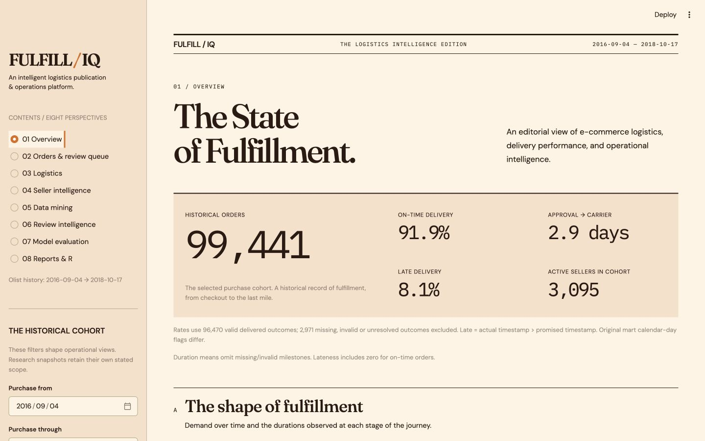

# Operations console and demonstration

The application is a **local historical-data simulation**. FastAPI owns all business
logic, prediction and database access. Streamlit calls documented HTTP endpoints;
Plotly provides interactive charts. There is no model training on startup or in UI.
The active model remains `20261024T031015-f87ea646`.

The current editorial edition retains all eight sections and the existing operational
workflows. See the [visual system, current screenshots and verification record](EDITORIAL_DESIGN.md).

## Start

From the repository root, with existing Olist warehouse and saved artifacts:

```sh
uv sync --locked --extra dev --extra console
./scripts/start_app.sh
```

Open [the console](http://127.0.0.1:8501) and [Swagger](http://127.0.0.1:8000/docs).
The launcher starts both services on loopback and stops its child processes on
Ctrl-C. Use `FULFILIQ_API_PORT` and `FULFILIQ_CONSOLE_PORT` for alternate ports.
Do not start a second copy against occupied ports. For separate terminals:

```sh
# Export the SAME locally generated token in BOTH terminals; never commit it.
export FULFILIQ_WRITE_TOKEN='replace-with-a-long-random-local-value'
uv run uvicorn fulfilliq.api.main:app --host 127.0.0.1 --port 8000
# Other terminal, with the same token:
uv run --extra console streamlit run src/fulfilliq/console/app.py \
  --server.address 127.0.0.1 --server.headless true --browser.gatherUsageStats false
```

The launcher automatically generates an ephemeral token shared by its two child
processes. A standalone API without `FULFILIQ_WRITE_TOKEN` disables review writes
(403). Requests to update reviews must send `Authorization: Bearer <token>`.
Tokens are never returned by the API or shown in console pages. This is a local,
single-team demonstration, without user accounts, roles or a multi-user audit log.
The console itself has no login. Keep both services on loopback; a public deployment
requires real authentication, authorization, TLS and deployment hardening.

## Prepare a fresh checkout explicitly

Data/model binaries are deliberately excluded from Git. Follow README download,
ingestion and offline artifact preparation instructions. Missing data/model/mining
outputs produce clear dependency errors. **Startup never regenerates artifacts.**
For the existing saved outputs, only regenerate itemsets if an older rules snapshot
has no itemset rows:

```sh
uv run fulfilliq build-insights --module rules
```

This mines the existing transaction representation; it does not train or change the
prediction model, seller clusters or review sentiment estimator. Other saved outputs
are reused. See [optional R setup and reproduction](../r_analysis/README.md).

## Demonstration walkthrough

1. **Overview:** verify 99,441 orders and 3,095 active sellers. Select a date range,
   customer state, seller or category. All operational charts use the same cohort.
   Exact-time late rate is about 8.1% among 96,470 valid delivered outcomes; 2,971
   missing, invalid or unresolved outcomes are excluded. The original mart's
   `is_late` uses calendar days; operational API rates consistently use the existing
   exact timestamp target, so these flags must not be interchanged.
2. **Orders & review queue:** browse chronological pages, choose a review capacity,
   then score the candidate page. Sorting is by saved-model probability. The capacity
   is local to the submitted page, not a global top-risk claim. Scores and model
   threshold categories are separate from human status. Latest canceled/incomplete
   orders can be unreconstructible; their unavailable reasons are explicit.
3. Inspect an order. Placement timestamps, products, sellers, customer state, prices,
   freight, dimensions and ZIP-centroid coordinates reconstruct the existing strict
   checkout request. Actual delivery, approval, carrier milestones, status and reviews
   are never accepted as replay inputs. Catalog/freight/promise availability at checkout
   is an assumption because Olist has no versioned catalog. Existing historical
   features still query only outcomes available before the purchase timestamp.
   The saved estimator was fitted on historical data, so replay is **not** a new
   independent backtest. Retrospective warnings remain visible.
4. Save investigation notes and choose pending/investigating/reviewed/escalated/resolved.
   Restart and confirm persistence. Stale revisions return 409 rather than losing edits.
   Export candidate or ranked queue tables as CSV. Notes should contain no personal data.
5. **Logistics:** compare duration and late-rate groups, filter operational bottlenecks,
   and inspect the separate full-history regional anomaly snapshot. Missing/invalid
   durations have explicit counts; seller/category groups overlap for shared orders.
6. **Seller intelligence:** select a seller, inspect performance, existing K-Medoids
   segment/features, matched segment peers and anomaly evidence. These snapshots use
   full history; the sidebar cohort dates do not re-estimate clusters.
7. **Data mining:** switch Apriori/FP-Growth, inspect frequent itemsets and late-delivery
   rules, compare actual runtimes and identical supports, view cluster summaries and
   anomaly scores/reasons. Display filters do not re-mine at lower thresholds.
8. **Review intelligence:** inspect star distributions, overlapping Portuguese lexical
   themes, keywords, seller/category groups and conservatively redacted excerpts.
   Only a small logistics/function-word vocabulary survives in excerpts; arbitrary
   names/content are masked. Examples are deterministic lexical matches, not a random
   sample. Star-supervised sentiment accuracy does not validate complaint detection.
   Saved summaries cover all history; the evidence endpoint supports seller/state/category.
9. **Model evaluation:** read saved metrics, calibration and temporal findings. No fit,
   tuning, calibration or promotion controls exist. Previously inspected test outcomes
   are not new independent confirmation. Existing experimental reports are preserved.
10. **Reports & R:** export reproducible Markdown and CSVs for the selected operational
    cohort. Mining findings clearly retain full-history scope. View dependencies,
    optional verified R Apriori comparison and four ggplot2 plots. Absent R outputs
    show setup instructions; Python workflows remain usable.

## Persistence and contracts

`data/processed/operations.sqlite3` contains `order_reviews_workflow`, completely
separate from `fulfilliq.sqlite3`. Schema migration v1 uses `PRAGMA user_version`;
unknown versions fail rather than silently overwriting data. Columns are `order_id`
(primary key), validated status, notes, revision and UTC update timestamp. Updates
use `BEGIN IMMEDIATE`, an expected revision and parameterized upsert. Unedited orders
have implicit pending status/revision 0. Unknown historical IDs return 404. Back up
this database separately; ingestion only rebuilds the historical warehouse. Notes
are stored locally as plaintext. Historical source tables are accessed read-only.

New APIs have Pydantic responses, bounded page/batch limits and filters. See
[API documentation](API.md). Existing routes and prediction response fields remain
compatible; the overview adds an active-seller count. R download filenames are an
allowlist and completed outputs are checked against warehouse provenance.

## Verification

```sh
uv run --extra dev --extra console pytest -q
uv run --extra dev ruff check src tests scripts
# Read-only real Olist smoke with isolated temporary workflow database:
uv run --extra dev python scripts/smoke_application.py
# With both services already running; renders all eight pages and scores a page:
uv run --extra console python scripts/verify_console.py
```

The new application tests do not fit a model. Existing training tests remain in the
regression suite. Actual execution evidence is in
[the integration record](results/application-integration-20261024.json).
The console supports paged order browsing; mining/seller explorer tables show their
stated bounded subset and expose paginated APIs for deeper access. This is not a live
carrier integration, automated incident resolver or validated intervention engine.



Earlier screenshots in `screenshots/overview.png` and `screenshots/r-report.png` document
the original integration checkpoint; the editorial design guide contains the current UI.

## Reliable investigation workflow (public-source sprint)

Source visibility is public; the running console/API remain localhost-only and the
write token is still required. No project source-code license has been selected.
Olist attribution and the dataset's separate CC BY-NC-SA terms remain unchanged.

Reproducible walkthrough with existing artifacts:

1. Open **Overview**, inspect a state's late rate, then use **Investigate customer
   state → Find orders in this region**. Dates, seller and category filters remain.
2. On **Orders & review queue**, optionally choose a historical order status or
   observed delivery outcome. These are retrospective discovery filters, not model
   inputs. Investigation counts summarize this discovery cohort before the workflow
   filter. Delivery outcome `unavailable` includes unresolved or invalid outcomes.
3. Use previous/next or the bounded **Go to page** input. Changing discovery filters
   resets to page one; navigating away and back retains page and selected order.
4. Choose capacity and **Score candidate page**. Ranking is strictly page-local,
   never cohort-wide. The run shows candidate/scored counts, UTC timestamp and model
   version. Ineligible reconstructions remain explicitly unavailable. The last four
   scored pages are cached per Streamlit session using candidate IDs, warehouse
   snapshot and active model version. Revisiting a valid cached page avoids inference;
   model/data changes invalidate its use. Changing capacity only adjusts the displayed
   budget. API/browser restarts clear scores, while saved investigations persist.
5. Filter the scored queue by workflow state, then **Inspect highest-risk match**, or
   select any candidate. Model probability stays separate from observed outcomes and
   human decisions. **Open seller evidence** and **Find this seller’s orders** connect
   investigation to existing seller/segment/anomaly outputs, preserving cohort filters.
6. Save a note/status, visit another page, and return. Counts/status refresh without
   rescoring. Forms submit the revision actually opened, rather than a newer revision
   fetched during Save. If another session saved first, the stale write is rejected and
   the draft remains visible. Copy any text to retain, then use **Reload saved review
   (discard draft)** before merging and saving again. Saved changes survive restarts.
7. Export the displayed candidates or status-filtered risk queue as CSV, or export an
   operational report under **Reports & R**. CSV rows match the displayed filter and
   risk ordering; formula-like text is escaped for spreadsheets. Local operational
   exports, secrets and databases must never be committed.

Verification commands remain in the guide above. The new automated checks cover
concurrent browser drafts, navigation, queue caching/invalidation, status counts,
outcome filters, pagination and CSV consistency. Real-data checks compare the filtered
RJ late-delivery cohort to an independent read-only warehouse query and exercise saved
model replay plus review persistence using a temporary workflow database. This avoids
adding demonstration notes to the shared operational database. No ML optimization,
retraining, recalibration or promotion is performed.

## Persistent cohort scoring

The launcher now starts a **third process**, the SQLite-backed scoring worker. Quick
**Score candidate page** remains page-local. The separate **Cohort Scoring — persistent
jobs** section freezes every matching candidate ID and filter, across all candidate pages.

1. Narrow discovery filters to at most **2,000 candidates** (default), then create a
   persistent job. Status/outcome-based selections are explicitly retrospective.
2. Refresh progress; navigate away or restart without losing it. Saved jobs are listed
   independently of current dashboard filters. Pending work needs the local worker.
3. Only completed jobs with a terminal scored/unavailable outcome for **every** candidate
   show a complete cohort-wide ranking. Others show preliminary results. All-unavailable
   cohorts finish with an empty scored queue and explicit unavailable reasons.
4. Choose Top N or a percentage of successfully scored orders, filter current investigation
   state, inspect a cohort order, and use the existing revision-checked review form. Changing
   capacity/status does not rescore. Results retain their original model/snapshot provenance.
5. **Export full filtered cohort CSV** exports all matching recorded results, independently
   of the visible 50-row result page. Existing larger jobs remain fully exportable if the
   configured creation limit is later reduced. The response includes `X-Ranking-Complete`.

Run a worker separately (same data/artifact/operational settings as the API):

```sh
uv run python -m fulfilliq.operations.worker
# One bounded iteration, useful for a controlled stop/resume demonstration:
uv run python -m fulfilliq.operations.worker --batch-size 50 --max-batches 1
# Real-data process restart demo, isolated jobs/notes, no shared history changes:
uv run --extra dev python scripts/verify_cohort_scoring.py
```

Defaults: 50 orders per chunk (configurable 1–100), 180-second lease (10–3,600), and
2,000 candidates/job. `FULFILIQ_SCORING_MAX_ORDERS` permits a local creation bound of
1–5,000; no unbounded job is accepted. `FULFILIQ_OPERATIONS_DIR` optionally relocates
both operational databases; default remains `data/processed/`. Worker memory is bounded
by the existing model plus a chunk; the API retains its existing warehouse cache.

The worker claims one job with `BEGIN IMMEDIATE` and a unique lease token. It reconstructs
strict checkout requests using the **same replay function** as the quick-scoring API,
then atomically commits a chunk and progress. No transaction is held during inference.
An expired/replaced claim cannot commit; unique job/order and job/sequence constraints
prevent duplicate results. Graceful signals finish the bounded current chunk and stop.
After an abrupt stop, the next worker automatically reclaims expired running work; at
most an uncommitted chunk is repeated. Cancel revokes the claim, preventing an in-flight
commit. Explicit resume supports canceled/failed jobs after the recorded snapshot is
restored. Changed snapshots become stale; create a new job rather than mixing versions.
Completed results remain historical snapshots. Failed chunks never appear completed.

Schema migration v1 lives in the separate `scoring.sqlite3`, leaving the existing review
schema/data untouched. `scoring_jobs` stores ID, immutable filter JSON, timestamps, state,
counts, model version, warehouse identifier, default capacity, sanitized error, and private
lease fields. `scoring_results` freezes IDs/sequences and stores pending/scored/unavailable
state, probability, original validated prediction JSON, reason, and processing timestamp.
Review statuses/notes remain in `operations.sqlite3`, and current status is joined for
queue display/export. Back up **both** operational databases. Neither is committed.

API: token-protected `POST /api/v1/scoring-jobs`, `POST /{id}/cancel`, `POST /{id}/resume`;
read-only `GET /api/v1/scoring-jobs`, `GET /{id}`, `GET /{id}/results`, and
`GET /{id}/export.csv`. Paths after the first share the `/api/v1/scoring-jobs` prefix.
Results accept capacity, review status, include-unavailable and bounded limit/offset.
OpenAPI documents the typed job/result contracts. Unknown IDs return 404, conflicts 409,
oversized/invalid cohorts 422, and unavailable saved models 503. No route trains a model
or executes the complete cohort synchronously. Keep services on localhost.

Observed real-data verification (24 October 2026): AL cohort **413 candidates**, first
worker stopped after **50**, fresh worker completed **411 scored + 2 unavailable**; CSV
contained **411** ranked rows. Isolated investigation persistence, ordering, duplicate
prevention and warehouse/active-model checksums passed. Runtime **18.65 s**, observed
worker-child peak RSS about **207 MiB** on this Mac; this excludes API/console memory.
The default 2,000-order bound is conservative, not a claim that 2,000 was load-tested.
No ML tuning/training/calibration/promotion occurred. Remaining limits are local-process
execution, manual progress refresh, lease-expiry recovery delay and no job-retention UI.
