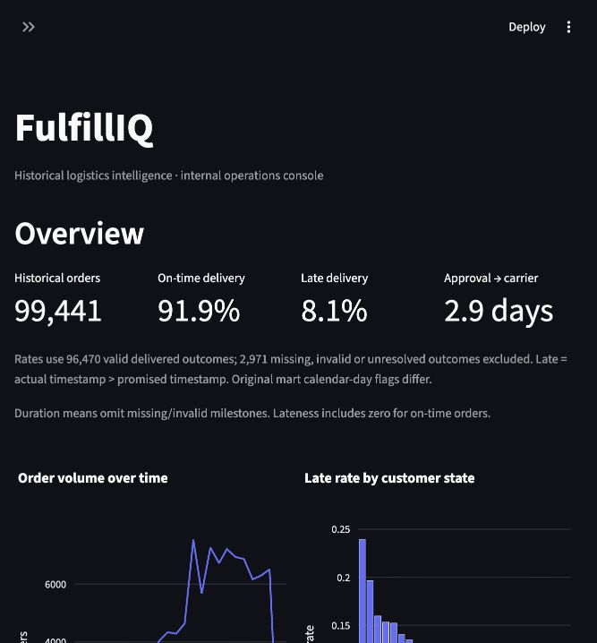
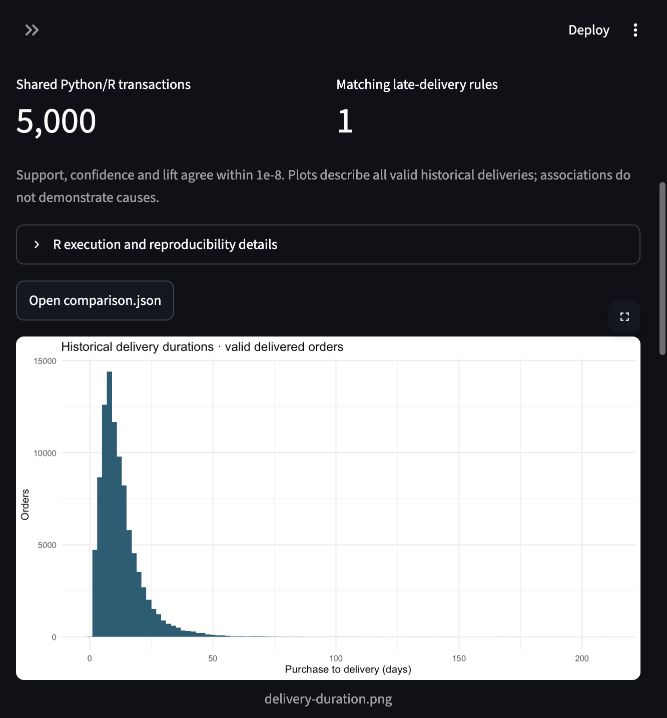

# Operations console and demonstration

The application is a **local historical-data simulation**. FastAPI owns all business
logic, prediction and database access. Streamlit calls documented HTTP endpoints;
Plotly provides interactive charts. There is no model training on startup or in UI.
The active model remains `20261024T031015-f87ea646`.

## Start

From the repository root, with existing Olist warehouse and saved artifacts:

```sh
uv sync --locked --extra dev --extra console
./scripts/start_app.sh
```

Open [the console](http://127.0.0.1:8501) and [Swagger](http://127.0.0.1:8000/docs).
The launcher starts both services on loopback and stops its child processes on
Ctrl-C. Use `FULFILIQ_API_PORT` and `FULFILIQ_CONSOLE_PORT` for alternate ports.
Do not start a second copy against occupied ports. For separate terminals:

```sh
# Export the SAME locally generated token in BOTH terminals; never commit it.
export FULFILIQ_WRITE_TOKEN='replace-with-a-long-random-local-value'
uv run uvicorn fulfilliq.api.main:app --host 127.0.0.1 --port 8000
# Other terminal, with the same token:
uv run --extra console streamlit run src/fulfilliq/console/app.py \
  --server.address 127.0.0.1 --server.headless true --browser.gatherUsageStats false
```

The launcher automatically generates an ephemeral token shared by its two child
processes. A standalone API without `FULFILIQ_WRITE_TOKEN` disables review writes
(403). Requests to update reviews must send `Authorization: Bearer <token>`.
Tokens are never returned by the API or shown in console pages. This is a local,
single-team demonstration, without user accounts, roles or a multi-user audit log.
The console itself has no login. Keep both services on loopback; a public deployment
requires real authentication, authorization, TLS and deployment hardening.

## Prepare a fresh checkout explicitly

Data/model binaries are deliberately excluded from Git. Follow README download,
ingestion and offline artifact preparation instructions. Missing data/model/mining
outputs produce clear dependency errors. **Startup never regenerates artifacts.**
For the existing saved outputs, only regenerate itemsets if an older rules snapshot
has no itemset rows:

```sh
uv run fulfilliq build-insights --module rules
```

This mines the existing transaction representation; it does not train or change the
prediction model, seller clusters or review sentiment estimator. Other saved outputs
are reused. See [optional R setup and reproduction](../r_analysis/README.md).

## Demonstration walkthrough

1. **Overview:** verify 99,441 orders and 3,095 active sellers. Select a date range,
   customer state, seller or category. All operational charts use the same cohort.
   Exact-time late rate is about 8.1% among 96,470 valid delivered outcomes; 2,971
   missing, invalid or unresolved outcomes are excluded. The original mart's
   `is_late` uses calendar days; operational API rates consistently use the existing
   exact timestamp target, so these flags must not be interchanged.
2. **Orders & review queue:** browse chronological pages, choose a review capacity,
   then score the candidate page. Sorting is by saved-model probability. The capacity
   is local to the submitted page, not a global top-risk claim. Scores and model
   threshold categories are separate from human status. Latest canceled/incomplete
   orders can be unreconstructible; their unavailable reasons are explicit.
3. Inspect an order. Placement timestamps, products, sellers, customer state, prices,
   freight, dimensions and ZIP-centroid coordinates reconstruct the existing strict
   checkout request. Actual delivery, approval, carrier milestones, status and reviews
   are never accepted as replay inputs. Catalog/freight/promise availability at checkout
   is an assumption because Olist has no versioned catalog. Existing historical
   features still query only outcomes available before the purchase timestamp.
   The saved estimator was fitted on historical data, so replay is **not** a new
   independent backtest. Retrospective warnings remain visible.
4. Save investigation notes and choose pending/investigating/reviewed/escalated/resolved.
   Restart and confirm persistence. Stale revisions return 409 rather than losing edits.
   Export candidate or ranked queue tables as CSV. Notes should contain no personal data.
5. **Logistics:** compare duration and late-rate groups, filter operational bottlenecks,
   and inspect the separate full-history regional anomaly snapshot. Missing/invalid
   durations have explicit counts; seller/category groups overlap for shared orders.
6. **Seller intelligence:** select a seller, inspect performance, existing K-Medoids
   segment/features, matched segment peers and anomaly evidence. These snapshots use
   full history; the sidebar cohort dates do not re-estimate clusters.
7. **Data mining:** switch Apriori/FP-Growth, inspect frequent itemsets and late-delivery
   rules, compare actual runtimes and identical supports, view cluster summaries and
   anomaly scores/reasons. Display filters do not re-mine at lower thresholds.
8. **Review intelligence:** inspect star distributions, overlapping Portuguese lexical
   themes, keywords, seller/category groups and conservatively redacted excerpts.
   Only a small logistics/function-word vocabulary survives in excerpts; arbitrary
   names/content are masked. Examples are deterministic lexical matches, not a random
   sample. Star-supervised sentiment accuracy does not validate complaint detection.
   Saved summaries cover all history; the evidence endpoint supports seller/state/category.
9. **Model evaluation:** read saved metrics, calibration and temporal findings. No fit,
   tuning, calibration or promotion controls exist. Previously inspected test outcomes
   are not new independent confirmation. Existing experimental reports are preserved.
10. **Reports & R:** export reproducible Markdown and CSVs for the selected operational
    cohort. Mining findings clearly retain full-history scope. View dependencies,
    optional verified R Apriori comparison and four ggplot2 plots. Absent R outputs
    show setup instructions; Python workflows remain usable.

## Persistence and contracts

`data/processed/operations.sqlite3` contains `order_reviews_workflow`, completely
separate from `fulfilliq.sqlite3`. Schema migration v1 uses `PRAGMA user_version`;
unknown versions fail rather than silently overwriting data. Columns are `order_id`
(primary key), validated status, notes, revision and UTC update timestamp. Updates
use `BEGIN IMMEDIATE`, an expected revision and parameterized upsert. Unedited orders
have implicit pending status/revision 0. Unknown historical IDs return 404. Back up
this database separately; ingestion only rebuilds the historical warehouse. Notes
are stored locally as plaintext. Historical source tables are accessed read-only.

New APIs have Pydantic responses, bounded page/batch limits and filters. See
[API documentation](API.md). Existing routes and prediction response fields remain
compatible; the overview adds an active-seller count. R download filenames are an
allowlist and completed outputs are checked against warehouse provenance.

## Verification

```sh
uv run --extra dev --extra console pytest -q
uv run --extra dev ruff check src tests scripts
# Read-only real Olist smoke with isolated temporary workflow database:
uv run --extra dev python scripts/smoke_application.py
# With both services already running; renders all eight pages and scores a page:
uv run --extra console python scripts/verify_console.py
```

The new application tests do not fit a model. Existing training tests remain in the
regression suite. Actual execution evidence is in
[the integration record](results/application-integration-20261024.json).
The console supports paged order browsing; mining/seller explorer tables show their
stated bounded subset and expose paginated APIs for deeper access. This is not a live
carrier integration, automated incident resolver or validated intervention engine.




